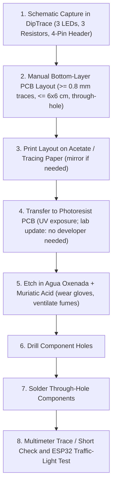

# PCB Design and Machine Project 2

> [!info] Document Metadata
> **Course:** `=this.course` | **Topic:** `=this.topic` | **Status:** `=this.status`

**Tags:** #[[Computer Science]] #[[NSETRON]] #[[Electronics]] #[[PCB Design and Machine Project 2]]

---

## Exam-Oriented Concept Summary

- **Machine Project 2 Overview:**
  - Design, lay out, chemically etch, drill, solder, and test a **single-layer through-hole Printed Circuit Board (PCB)** in **DipTrace** acting as a **3-LED traffic-light interface board** driven by an **ESP32**.
  - **Circuit Structure (Per LED):** `ESP32 GPIO -> Current-Limiting Resistor -> LED -> GND` (three parallel branches sharing a common `GND` return on a **4-pin header**: `GPIO1`, `GPIO2`, `GPIO3`, `GND`).
- **Exact Board, Material & DipTrace Design Specifications:**
  - **PCB Substrate Type:** **Photoresist (presensitized) single-sided PCB** — strictly **NOT** Universal PCB and **NOT** copper-only PCB.
  - **Board Dimensions:** Target size **$5\text{ cm} \times 5\text{ cm}$** (recommended to bring spare PCBs as first etches often fail); **maximum permitted size is $6\text{ cm} \times 6\text{ cm}$**.
  - **Components:**
    - `3` LEDs: **Red, Green, and Orange/Yellow** (through-hole footprints).
    - `3` Current-limiting resistors: values between **$500\ \Omega$ and $5\text{ k}\Omega$** (through-hole footprints).
    - `1` **4-pin header** (`GPIO1`, `GPIO2`, `GPIO3`, `GND`) with `4` female-to-female jumper wires connecting to the ESP32.
  - **DipTrace Design Rules:**
    1. Create a proper schematic in DipTrace.
    2. Convert the schematic to a PCB layout.
    3. Use **through-hole components only**.
    4. Use **single-layer copper (bottom layer only)**.
    5. **Route all traces manually (NO autorouter)**.
    6. Include: **board outline**, **labels for GPIO pins**, **clear `GND` marking**, and **proper spacing between traces** (neat and symmetrical if possible).
    7. **Minimum trace width:** **$0.8\text{ mm}$** (thicker traces recommended for beginners; keep traces short and clean).
- **Exact Project 2 Fabrication Process & Chemical Update:**
  1. **Print PCB layout** onto **acetate / tracing paper** (mirror if needed).
  2. **Transfer to copper board** (UV exposure onto presensitized photoresist PCB; per the lab-technician update, a separate developer chemical is not needed, though PCB kits with bundled developer sachets and legacy flows list a developer bath step before etching).
  3. **Etch** manually using **Hydrogen Peroxide (Agua Oxenada)** and **Hydrochloric Acid (Muriatic Acid)**.
  4. **Drill** component holes.
  5. **Solder** components.
  6. **Test with ESP32** running the supplied traffic-light program.
- **Safety, Testing & Inspection Rules:**
  - **Mandatory Safety:** Wear **gloves** and long sleeves/lab gown to shield skin from etching acids, do **NOT inhale fumes or lead**, and **dispose of chemicals properly**. Never shake/agitate etching chemicals violently to rush etching.
  - **Post-Soldering Tests:** Verify each LED lights independently, **zero short circuits**, **zero broken traces**, and **board does not overheat**.
  - **Investigating a Thin or Suspected Broken Trace:** Use a **multimeter** to measure **resistance / continuity between the two endpoints of the trace** (near $0\ \Omega$ = intact; infinite / `OL` = broken trace). Software tools like DipTrace or TinkerCAD cannot inspect physical etching defects on the fabricated copper board!
- **Deliverables & Grading Rubric (`50 Points` Total):**
  - **Document:** Cover Page, AI Disclosure, Discussion ($\le 300\text{ words}$), DipTrace schematic, PCB layout, photo of etched board (before soldering), photo of soldered board (both sides), Proof of Actual Demonstration (Instructor Signature if applicable), plus a **2-minute max Video of Working Prototype**.
  - **Points Breakdown:** Schematic Design (`5`) + PCB Layout Quality (`10`) + Prototype Fabrication Quality (`15`) + Functionality (`5`) + Cleanliness & Safety Compliance (`5`) + Documentation (`10`) = `50 pts`.

---

## Key Parameters & Design Checks Table

| Parameter / Rule | Project 2 Specification | Exam / Inspection Purpose |
| :--- | :--- | :--- |
| CAD Software | DipTrace (manual routing only; no autorouter) | Schematic capture $\to$ bottom-layer layout conversion |
| Target vs. Max PCB Size | Target $5\text{ cm} \times 5\text{ cm}$; Max $6\text{ cm} \times 6\text{ cm}$ | Checking board outline compliance |
| Minimum Trace Width | $0.8\text{ mm}$ (thicker recommended) | Prevents over-etching breaks on manual chemical etches |
| Copper & Component Type | Single-layer (bottom copper only), through-hole only | No SMD parts, no top-layer copper traces |
| PCB Substrate | Photoresist single-sided PCB | Reject Universal perfboard and plain copper-only board |
| Resistor Range | $500\ \Omega$ to $5\text{ k}\Omega$ (one per LED) | Limits ESP32 GPIO current per branch |
| Header Signals | 4-pin header: `GPIO1`, `GPIO2`, `GPIO3`, `GND` | Connects via 4 F-F jumpers to ESP32 |
| Etching Chemicals | Agua Oxenada ($\text{H}_2\text{O}_2$) + Muriatic Acid ($\text{HCl}$) | Dissolves exposed unwanted copper outside masked traces |

---

## Worked Numerical Examples

### Example 1: ESP32 GPIO Current-Limiting Resistor Sizing Check
An ESP32 GPIO pin outputs $V_{\text{GPIO}} = 3.3\text{ V}$ to drive one Project 2 LED branch (`GPIO -> R -> LED -> GND`) with LED forward voltage $V_{\text{LED}} = 2.0\text{ V}$ (note: Project 2 specifies $R \in [500\ \Omega,\ 5\text{ k}\Omega]$). Calculate the branch LED current at the two boundary resistor values: (a) $R = 500\ \Omega$ and (b) $R = 5\text{ k}\Omega$, plus (c) a common $1\text{ k}\Omega$ choice.

**Solution:**
1. Voltage dropped across the series resistor:
   $$V_R = V_{\text{GPIO}} - V_{\text{LED}} = 3.3\text{ V} - 2.0\text{ V} = 1.3\text{ V}$$
2. Branch current at each resistor value:
   - At $R = 500\ \Omega$: $I = \frac{1.3\text{ V}}{500\ \Omega} = 2.6\text{ mA}$
   - At $R = 1\text{ k}\Omega$: $I = \frac{1.3\text{ V}}{1000\ \Omega} = 1.3\text{ mA}$
   - At $R = 5\text{ k}\Omega$: $I = \frac{1.3\text{ V}}{5000\ \Omega} = 0.26\text{ mA}$
   All values stay safely well below typical microcontroller GPIO current limits while keeping $P_R = I^2 R \le 3.38\text{ mW}$.

### Example 2: Board Area Compliance & Multimeter Continuity Check
(a) A student lays out a $4.5\text{ cm} \times 5.5\text{ cm}$ board with $0.9\text{ mm}$ traces. Does it pass Project 2 size and trace width limits? What is its area compared to the maximum $6\text{ cm} \times 6\text{ cm}$ allowance?
(b) After etching and before soldering, a multimeter placed across `GPIO2` header pad and the `R2` pad reads $\infty$ (`OL`), while `GPIO1` to `R1` reads $0.2\ \Omega$. Diagnose both readings.

**Solution:**
1. Dimensions: $4.5\text{ cm} \le 6\text{ cm}$ and $5.5\text{ cm} \le 6\text{ cm}$ (area $= 24.75\text{ cm}^2 \le 36\text{ cm}^2$ maximum, even fitting close to the $25\text{ cm}^2$ target). Trace width $0.9\text{ mm} \ge 0.8\text{ mm}$ minimum $\implies$ **PASS**.
2. Continuity check:
   - `GPIO1` to `R1` ($0.2\ \Omega$): continuous intact copper trace.
   - `GPIO2` to `R2` (`OL` / infinite resistance): **broken trace** (likely over-etched or hairline nick); must be repaired (e.g., bridged cleanly when soldering) before demoing so `LED2` can turn on.

---

## Laboratory / Project Recap

### Machine Project 2: Basic PCB Design and Fabrication of a 3-LED Interface Board
- **Objective:** Capture a 3-LED + 3-resistor + 4-pin header schematic in DipTrace, lay out a single-layer through-hole PCB manually, fabricate it via chemical etching on photoresist board, solder components, and demonstrate traffic-light control using an ESP32.
- **Materials & Tools:** Photoresist single-sided PCB ($5\times 5\text{ cm}$ recommended, $\le 6\times 6\text{ cm}$ max), acetate/tracing paper printout, Agua Oxenada ($\text{H}_2\text{O}_2$), Muriatic Acid ($\text{HCl}$), gloves/PPE, drill, soldering iron & solder, DipTrace, Red/Green/Orange(Yellow) LEDs, $3\times$ resistors ($500\ \Omega\text{--}5\text{ k}\Omega$), 4 F-F jumpers, ESP32, multimeter.
- **Numbered Design & Fabrication Flow (Exact Project 2 Steps):**
  1. Create proper schematic in DipTrace (`GPIO1/2/3 -> R -> LED -> GND`).
  2. Convert schematic to PCB layout (through-hole only, bottom-layer copper only, manual routing $\ge 0.8\text{ mm}$, board outline, GPIO & `GND` labels, proper spacing).
  3. Print PCB layout onto acetate/tracing paper (mirror if needed).
  4. Transfer layout to photoresist copper board (UV exposure; note lab technician update that separate developer is not needed, though legacy sequences list Developer Mixing between UV exposure and etching).
  5. Etch manually using Agua Oxenada + Muriatic Acid while wearing gloves and avoiding fumes.
  6. Drill component holes and solder LEDs, resistors, and header pins cleanly.
  7. Inspect/test continuity with multimeter (no shorts, no broken traces), attach ESP32, verify independent LED control without overheating, and run the traffic-light demo program.
- **Typical Failure Modes:** Using universal perfboard or bare copper board instead of photoresist PCB; autorouting or using top copper layer; trace width $< 0.8\text{ mm}$ causing open etched traces; forgetting to mirror printout; over-exposing presensitized board to ambient room light for 20 minutes *before* taping the printout (destroying mask contrast!); poor chemical safety or cold/bridged solder joints.

---

## Circuit & Procedure Diagrams

### Machine Project 2 Schematic (`3-LED ESP32 Interface Board`)

```circuit:mp2-led-board
  4-Pin Header
   [ GPIO1 ] ----[ R1 (500-5k) ]----(>| LED1 Red    )----+
   [ GPIO2 ] ----[ R2 (500-5k) ]----(>| LED2 Green  )----+
   [ GPIO3 ] ----[ R3 (500-5k) ]----(>| LED3 Orange )----+
   [  GND  ] <-------------------------------------------+
```

### Exact Project 2 Design & Fabrication Sequence



---

## Exam Traps & Quick-Recall Checklist

- **Investigating a thin/broken etched PCB trace:** Always use a **multimeter to check resistance/continuity** between the two trace endpoints -- NEVER re-simulate in DipTrace or TinkerCAD to inspect a physical copper break.
- **Safe PCB etching:** Wear **gloves and long sleeves/lab gown**; do NOT violently agitate acids or expose bare photoresist PCB to light for 20 minutes before taping the printout mask!
- **Exact construction order:** `Layout Printing -> UV Exposure -> (Developer Mixing when bundled / skipped per lab update) -> Agua Oxenada + HCl Mixing -> Drilling -> Soldering -> ESP32 Installation and Programming`. Note that **Drilling ALWAYS precedes Soldering**!
- **Project 2 strict DipTrace rules:** Bottom layer only, through-hole only, **NO autorouter**, minimum **$0.8\text{ mm}$ trace width**, max **$6\text{ cm} \times 6\text{ cm}$** ($5\times 5\text{ cm}$ target), resistor range **$500\ \Omega$ to $5\text{ k}\Omega$**, LEDs **Red, Green, Orange/Yellow**.
- **Board material trap:** Must be **photoresist single-sided PCB**—Universal PCB and plain copper-only PCB are explicitly disallowed.

---

## Multiple Choice Questions

1. A fabricated Machine Project 2 PCB has a very thin etched copper trace that looks like it may be broken. What is the best way to check whether the trace is intact?
    - **A)** Re-run the circuit simulation inside DipTrace
    - **B)** Re-build the circuit in TinkerCAD for trace diagnostics
    - **C)** Rebuild the whole circuit on a solderless breadboard
    - **D)** Measure resistance/continuity across the two endpoints of the trace using a multimeter

2. Which practice follows proper Machine Project 2 PCB chemical etching and safety procedure?
    - **A)** Wear gloves and protective long sleeves/lab gown while handling etching solutions and avoid inhaling fumes
    - **B)** Shake the acid mixture violently so etching finishes as quickly as possible
    - **C)** Remove the protective film and leave the presensitized PCB under bright light for 20 minutes before placing the printout mask
    - **D)** Dispose of used acid etching liquid directly down an unlabeled sink without neutralization or proper disposal

3. What is the correct physical sequence of steps for fabricating and testing the Machine Project 2 board?
    - **A)** Layout Printing, Developer Mixing, Agua Oxenada + HCl Mixing, Soldering, Drilling, ESP32 Programming
    - **B)** UV Exposure, Agua Oxenada + HCl Mixing, Developer Mixing, Drilling, Soldering, ESP32 Programming
    - **C)** Layout Printing, UV Exposure, Developer Mixing, Agua Oxenada + HCl Mixing, Drilling, Soldering, ESP32 Installation and Programming
    - **D)** TinkerCAD Printing, Developer Mixing, Agua Oxenada + HCl Mixing, Drilling, Soldering, ESP32 Programming

4. [MSQ] Which of the following design rules are mandatory in Machine Project 2 DipTrace specifications? (Select all that apply)
    - **A)** Use through-hole components only on a single-layer bottom copper layout
    - **B)** Route all traces manually without using the DipTrace autorouter
    - **C)** Maintain a minimum trace width of $0.8\text{ mm}$ and keep board dimensions within $6\text{ cm} \times 6\text{ cm}$
    - **D)** Use a Universal perfboard or plain un-sensitized copper-only board for etching

5. [MSQ] Which components and pin labels must be present on the Machine Project 2 board? (Select all that apply)
    - **A)** Three LEDs (Red, Green, and Orange/Yellow) with three current-limiting resistors ($500\ \Omega\text{--}5\text{ k}\Omega$)
    - **B)** A 4-pin header labeled `GPIO1`, `GPIO2`, `GPIO3`, and `GND`
    - **C)** An onboard $220\text{ V}$ AC transformer and `7805` regulator
    - **D)** Board outline and clear `GND` marking

6. [INPUT] According to Machine Project 2 rules, what is the **minimum allowed PCB trace width** in millimeters ($\text{mm}$)?

7. [INPUT] What is the **maximum permitted PCB square area** in $\text{cm}^2$ given Machine Project 2's maximum board dimension limit of $6\text{ cm} \times 6\text{ cm}$?

8. What are the two etching chemicals specified in Machine Project 2?
    - **A)** Vinegar and sodium bicarbonate
    - **B)** Agua Oxenada (Hydrogen Peroxide) and Muriatic Acid (Hydrochloric Acid)
    - **C)** Isopropyl alcohol and flux paste
    - **D)** Sulfuric acid and distilled acetone

9. [BLANK] Complete the Machine Project 2 `50`-point grading rubric summary below:

| Grading Criteria | Points |
| :--- | :--- |
| Schematic Design | {{1}} |
| PCB Layout Quality | 10 |
| Prototype Fabrication Quality | {{2}} |
| Functionality | 5 |
| Cleanliness & Safety Compliance | 5 |
| Documentation | {{3}} |

10. In the Machine Project 2 guidelines, what chemical preparation update did the lab technician announce?
    - **A)** No etching acid is required if using DipTrace
    - **B)** There is no need for a separate developer chemical (though some bundled PCBs include developer sachets)
    - **C)** Drilling should be performed before UV exposure
    - **D)** Only two LEDs should be soldered instead of three

### Answer Key & Explanations

1. **D)** Physical trace integrity on an etched PCB is verified directly using a multimeter's resistance or continuity mode between trace endpoints (near $0\ \Omega$ = intact, infinite/`OL` = open break).
2. **A)** Safe PCB etching mandates gloves, skin coverage, fume avoidance, and proper disposal; violent shaking splashes acid, and pre-exposing photoresist destroys the pattern before masking.
3. **C)** Layout printing precedes UV exposure, followed by chemical processing/etching, drilling component holes *before* soldering, soldering components, and finally connecting/programming the ESP32.
4. **A, B, C)** Machine Project 2 enforces through-hole parts, bottom-layer-only manual routing (no autorouter), $\ge 0.8\text{ mm}$ trace width, and $\le 6\text{ cm} \times 6\text{ cm}$ size on a **photoresist single-sided PCB** (never Universal or copper-only boards).
5. **A, B, D)** The 3-LED ESP32 interface board contains Red/Green/Orange(Yellow) LEDs, three $500\ \Omega\text{--}5\text{ k}\Omega$ resistors, a 4-pin header (`GPIO1..3`, `GND`), board outline, and `GND` label; the AC power supply belongs to supporting Project 1.
6. **[0.8; 0.80; 0.8 mm; 0.8mm]** Machine Project 2 layout rules explicitly mandate a minimum trace width of $0.8\text{ mm}$ for easier manual etching.
7. **[36; 36.0; 36 cm2; 36 cm^2]** Maximum dimensions $6\text{ cm} \times 6\text{ cm} = 36\text{ cm}^2$.
8. **B)** Machine Project 2 etching instructions specify Agua Oxenada (Hydrogen Peroxide) and Muriatic Acid (Hydrochloric Acid).
9. **[1: 5; 2: 15; 3: 10]** The `50`-point rubric allocates: Schematic `5`, Layout `10`, Fabrication `15`, Functionality `5`, Cleanliness & Safety `5`, Documentation `10` (Total `50`).
10. **B)** As confirmed by the lab technician, there is no need for a separate developer chemical (although some bundled PCB kits include developer sachets, which are also acceptable).

## References & Navigation

- **Previous Topic:** [[Principles of Communication]]
- **Next Topic:** [[Written Exam Coverage and Formula Sheet]]
- **Related Notes:** [[Basic Electricity and Electronic Components]], [[Resistors]], [[Diodes]]
