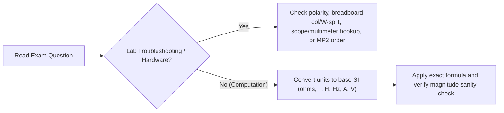

# Written Exam Coverage and Formula Sheet

> [!info] Document Metadata
> **Course:** `=this.course` | **Topic:** `=this.topic` | **Status:** `=this.status`

**Tags:** #[[Computer Science]] #[[NSETRON]] #[[Electronics]] #[[Written Exam Coverage and Formula Sheet]]

---

## Exam Format & Coverage Scope

- **Exam Format:** Individual, **written pen-and-paper** examination (`NSETRON - Practical Electricity and Electronics`).
- **Official Reviewer Format (`NSETRON exam-reviewer with NO answers.pdf`):** 31 four-option multiple-choice items across 6 pages (PDF labels `Question 1` through `Question 30` with duplicate `#10`, skipped `#12`, and duplicate `#28`); no fixed point values or exam time limit are stated in the source PDF.
- **Included Scope:** ALL laboratory experiments (`Lab 1` through `Lab 6` and `Lab 8`, noting `Lab 7` is absent/renumbered in the course module list) + **Machine Project 2** (DipTrace single-layer PCB design & etching), plus supporting AC/DC circuit theory, wiring, voltage dividers/comparators, and AM/FM communication fundamentals.
- **Excluded Scope:** Machine Project 1 (*Linear Power Supply with Full-Wave Bridge Rectifier*, `Power Supply FWBT.docx`) is **not exam coverage** and serves only as supporting context in [[AC Circuits]].

---

## Coverage Matrix (Labs & Projects -> Modules -> Notes)

| Lab / Project | Core Hardware / Tool | Assigned Module | Note Link |
| :--- | :--- | :--- | :--- |
| DC Theory Foundations | Ohm's Law, series/parallel, V/A/Ohm meters, dB | Module 01 | [[Basic Electrical Theory]] |
| **Lab 1: The Light Bulb** + Breadboards | 830-hole breadboard (`"W"` split), switch, $1\text{ k}\Omega$/$10\text{ k}\Omega$/$100\text{ k}\Omega$, $50\text{ k}\Omega$ pot, LED, L/C AC-DC | Module 02 | [[Basic Electricity and Electronic Components]] |
| **Lab 2: Resistors** | Series ($3.3\text{ k}\Omega + 100\text{ k}\Omega$), parallel, dual LED branches, combined VR splitter, color codes | Module 03 | [[Resistors]] |
| **Lab 3: Capacitors** | Asymmetric RC charge/discharge ($3.3\text{ k}\Omega$/$1\text{ k}\Omega$ vs. $10\text{ k}\Omega$), series ($9.1\ \mu\text{F}$), parallel ($110\ \mu\text{F}$), loose-wire | Module 04 | [[Capacitors]] |
| **Lab 4: Diodes** | Si diode ($0.7\text{ V}$), GaAs LED ($1.5\text{ V}$), anti-parallel dual LED capacitor indicator, 3 models | Module 05 | [[Diodes]] |
| AC Circuits *(MP1 supporting only)* | RMS/peak, $X_L$, $X_C$, $Z$, ELI/ICE, VA vs. W, Power Factor, transformers | Module 06 | [[AC Circuits]] |
| **Lab 5: Transistors** | NPN switch, Base vs. Collector LED gain & $33\text{ k}\Omega$ saturation ($\text{gain}\approx 3$), B-C shorted diode | Module 07 | [[Transistors]] |
| **Lab 6: Oscilloscope** *(Group 8 report)* | Rigol scope calibration, $T = 1/f$, $V_{pp}$, QuickPrint1 ($30\text{ kHz}$ square) & QuickPrint2 ($249\text{ Hz}$ sine), SNR, quantization | Module 08 | [[Oscilloscope]] |
| *(Lab 7)* | **Gap / Renumbered:** Skipped on module page; Lab 8 docx header internally reads `LABORATORY ACTIVITY #7` | --- | --- |
| Ampacity & Wiring *(no local lab/video)* | AWG Table 2-1 ($\Omega/\text{km}$), $I^2 R$ heating, 3-wire earth ground, series fuses & breakers | Module 09 | [[Ampacity and Wiring]] |
| Sensor Controls, Comparator & Divider *(no local lab/video)* | Multi-tap voltage divider, closed-loop op-amp vs. open-loop comparator, elastomer/capacitive/photoelectric/encoder sensors | Module 10 | [[Sensor Controls, Comparator and Voltage Divider]] |
| **Lab 8: Analog Modulation (AM & FM)** | LabAlive AM ($m$, DSB-SC via $\hat{s}=0$, envelope detector), FM ($\beta = k_m\hat{m}/f_m$, Bessel null $\beta \approx 2.405$, limiters, pre/deemphasis) | Module 11 | [[Principles of Communication]] |
| **Machine Project 2: PCB Design** | DipTrace bottom-layer manual routing ($\ge 0.8\text{ mm}$, $\le 6\times 6\text{ cm}$), photoresist PCB, $\text{H}_2\text{O}_2 + \text{HCl}$ etch, ESP32 3-LED test | Module 12 | [[PCB Design and Machine Project 2]] |

---

## Consolidated Master Formula Sheet

| Topic | Formula Name | Expression | Units |
| :--- | :--- | :--- | :--- |
| DC Circuits | Ohm's Law & Conductance | $V = I R,\quad I = \frac{V}{R},\quad R = \frac{V}{I},\quad G = \frac{1}{R}$ | $\text{V}, \text{A}, \Omega, \text{S}$ |
| DC Power | Electrical Power & Energy | $P = V I = I^2 R = \frac{V^2}{R},\quad W = P \cdot t$ | $\text{W}, \text{J}\ (\text{or Wh})$ |
| Decibels | Power Gain / Loss | $\text{dB} = 10 \log_{10}\left(\frac{P_2}{P_1}\right)$ | $\text{dB}$ |
| Resistors | Series & Parallel $R$ | $R_{\text{ser}} = \sum R_i,\quad \frac{1}{R_{\text{par}}} = \sum \frac{1}{R_i},\quad R_{P2} = \frac{R_1 R_2}{R_1 + R_2}$ | $\Omega$ |
| Resistors | Tolerance Range | $R_{\min} = R_{\text{nom}}(1 - t),\quad R_{\max} = R_{\text{nom}}(1 + t)$ | $\Omega$ |
| Dividers | Voltage Divider | $V_{\text{out}} = V_S \frac{R_{\text{bottom}}}{R_{\text{top}} + R_{\text{bottom}}}$ | $\text{V}$ |
| Capacitors | Charge, Energy & $\tau$ | $Q = C V,\quad E = \frac{1}{2} C V^2,\quad \tau = R C$ | $\text{C}, \text{J}, \text{s}$ |
| Capacitors | Parallel & Series $C$ | $C_{\text{par}} = \sum C_i,\quad \frac{1}{C_{\text{ser}}} = \sum \frac{1}{C_i},\quad C_{S2} = \frac{C_1 C_2}{C_1 + C_2}$ | $\text{F}\ (\mu\text{F}, \text{pF})$ |
| Diodes | Series Forward Current | $I_D = \frac{V_S - V_F}{R}\quad (V_{\text{Si}} \approx 0.7\text{ V},\ V_{\text{Ge}} \approx 0.3\text{ V},\ V_{\text{LED}} \approx 1.5\text{ V})$ | $\text{A}$ |
| Transistors | BJT Current & Gain | $I_E = I_C + I_B,\quad \beta = H_{FE} = \frac{I_C}{I_B}$ | $\text{A}$, ratio |
| Waveforms | Frequency, Period & RMS | $f = \frac{1}{T},\quad V_{\text{rms}} = 0.707 V_p,\quad V_p = 1.414 V_{\text{rms}},\quad V_{pp} = 2 V_p$ | $\text{Hz}, \text{s}, \text{V}$ |
| Scope & ADC | Screen & Quantization | $T = N_{\text{h}} (\text{Time/div}),\quad V_{pp} = N_{\text{v}} (\text{V/div}),\quad L = 2^n$ | $\text{s}, \text{V}, \text{levels}$ |
| AC Reactance | Inductive & Capacitive | $X_L = 2\pi f L,\quad X_C = \frac{1}{2\pi f C},\quad f_r = \frac{1}{2\pi\sqrt{LC}}$ | $\Omega, \text{Hz}$ |
| AC Impedance | Series RLC & Power Factor | $Z = \sqrt{R^2 + (X_L - X_C)^2},\quad S = V_{\text{rms}}I_{\text{rms}},\quad \text{PF} = \frac{P}{S} = \frac{R}{Z} = \cos\phi$ | $\Omega, \text{VA}, \text{W}$ |
| Transformers | Ideal Turns & Impedance | $\frac{V_p}{V_s} = \frac{N_p}{N_s} = \frac{I_s}{I_p},\quad \frac{Z_p}{Z_s} = \left(\frac{N_p}{N_s}\right)^2$ | $\text{V}, \text{A}, \Omega$ |
| Wire Losses | AWG Wire Resistance & Heat | $R_{\text{wire}} = r_{\text{km}} L_{\text{km}},\quad V_{\text{drop}} = I R_{\text{wire}},\quad P_{\text{loss}} = I^2 R_{\text{wire}}$ | $\Omega, \text{V}, \text{W}$ |
| Radio & AM | Wavelength & AM Modulation | $\lambda = \frac{3 \times 10^8}{f} = \frac{300}{f_{\text{MHz}}},\quad m = \frac{V_m}{V_c} = \frac{V_{\max} - V_{\min}}{V_{\max} + V_{\min}},\quad \text{BW}_{\text{AM}} = 2 f_m$ | $\text{m}, \text{Hz}$ |
| AM Power | Carrier & Sideband Power | $P_T = P_C\left(1 + \frac{m^2}{2}\right),\quad P_{\text{USB}} = P_{\text{LSB}} = \frac{P_C m^2}{4}$ | $\text{W}$ |
| FM | Modulation Index & Bessel BW | $\beta = \frac{\Delta f_{\max}}{f_m} = \frac{k_m \hat{m}}{f_m},\quad \text{BW}_{\text{FM}} = 2 f_m N$ | ratio, $\text{Hz}$ |

---

## Metric Prefix, Energy & Color-Code Reference Tables

### Metric Prefixes (`Basic Electrical Theory.pdf`)

| Prefix | Symbol | Power of 10 | Multiplier | Common Electronics Example |
| :--- | :---: | :---: | :--- | :--- |
| Giga | $\text{G}$ | $10^9$ | $1,000,000,000$ | $\text{GHz}$ microwave frequencies |
| Mega | $\text{M}$ | $10^6$ | $1,000,000$ | $\text{MHz}$ RF carriers, $\text{M}\Omega$ resistors |
| kilo | $\text{k}$ | $10^3$ | $1,000$ | $\text{k}\Omega$ resistors, $\text{kHz}$ audio/IF |
| centi | $\text{c}$ | $10^{-2}$ | $0.01$ | $\text{cm}$ PCB size ($5\text{ cm} \times 5\text{ cm}$) |
| milli | $\text{m}$ | $10^{-3}$ | $0.001$ | $\text{mA}$ LED current, $\text{mm}$ trace width, $\text{mH}$ |
| micro | $\mu$ | $10^{-6}$ | $0.000001$ | $\mu\text{F}$ electrolytics ($100\ \mu\text{F}$), $\mu\text{s}$ scope grid |
| nano | $\text{n}$ | $10^{-9}$ | $10^{-9}$ | $\text{nF}$ film/ceramic caps, $\text{nH}$ coils |
| pico | $\text{p}$ | $10^{-12}$ | $10^{-12}$ | $\text{pF}$ RF disc capacitors ($10^6\text{ pF} = 1\ \mu\text{F}$) |

### 4-Band Resistor Color Code & Standard Decade Values (Malestrom Ch. 6)

- **Color Digits (`0–9`):** Black (`0`), Brown (`1`), Red (`2`), Orange (`3`), Yellow (`4`), Green (`5`), Blue (`6`), Violet (`7`), Gray (`8`), White (`9`). Multiplier $= 10^{\text{digit}}$ (Gold $= \times 0.1$, Silver $= \times 0.01$). Tolerance (Band 4): Gold $= \pm 5\%$, Silver $= \pm 10\%$, None $= \pm 20\%$.
- **E12 ($\pm 10\%$) Standard Multiples:** `1.0, 1.2, 1.5, 1.8, 2.2, 2.7, 3.3, 3.9, 4.7, 5.6, 6.8, 8.2`
- **E24 ($\pm 5\%$) Additional Multiples:** `1.1, 1.3, 1.6, 2.0, 2.4, 3.0, 3.6, 4.3, 5.1, 6.2, 7.5, 9.1`

---

## Top Written-Exam Mistakes & Triage Flow

1. **Forgetting to invert $1/R_T$ (parallel resistors) or $1/C_T$ (series capacitors):** Always check that $R_{\text{par}} < R_{\min}$ and $C_{\text{ser}} < C_{\min}$.
2. **Confusing breadboard columns (`a-e`, `f-j`) vs. `"W"` rail breaks:** Same column shorts components; opposite sides of `"W"` on the DLSU-CT rail create an open ground!
3. **Mixing up oscilloscope vs. spectrum analyzer horizontal axes:** Scope = Time; Spectrum Analyzer = Frequency. Both can tap the same circuit node safely.
4. **Confusing $V_{\text{rms}}$, $V_p$, and $V_{pp}$:** $V_{pp} = 2 V_p$ and $V_p = 1.414 V_{\text{rms}}$.
5. **Reversing PCB fabrication order:** Print layout $\to$ UV expose $\to$ (develop if applicable) $\to$ etch ($\text{H}_2\text{O}_2 + \text{HCl}$) $\to$ **drill before soldering** $\to$ solder $\to$ test continuity/ESP32.

---

## Multiple Choice Questions

1. Which pair of laboratory modifications uses the exact **inverse** mathematical combination rule compared to resistors?
    - **A)** Parallel inductors vs. series inductors
    - **B)** Series capacitors combine using the product-over-sum / reciprocal formula like parallel resistors, while parallel capacitors add directly like series resistors
    - **C)** Series voltage sources vs. parallel current sources
    - **D)** Series diodes vs. parallel Zener diodes

2. Which measuring instrument configuration would **damage the meter or blow its fuse** if connected across an energized load resistor?
    - **A)** A voltmeter connected in parallel across the load
    - **B)** An oscilloscope probe connected across the load with ground clip on circuit ground
    - **C)** An ammeter connected directly in parallel across the voltage supply / load
    - **D)** A spectrum analyzer connected in parallel at the same node as an oscilloscope

3. [MSQ] Which of the following statements represent verified hardware and process constraints from the NSETRON course labs and Machine Project 2? (Select all that apply)
    - **A)** On the DLSU-CT breadboard, the `"W"` symbol splits the left and right halves of the horizontal power/ground bus rails
    - **B)** In Machine Project 2, minimum trace width in DipTrace is $0.8\text{ mm}$ on a bottom-layer-only photoresist PCB routed manually
    - **C)** In Lab 3, replacing a $3.3\text{ k}\Omega$ charging resistor with $1\text{ k}\Omega$ speeds up capacitor charging without changing the discharge time through $10\text{ k}\Omega$
    - **D)** In Lab 5 Part 3, shorting Base and Collector turns a BJT into a high-gain amplifier with $\beta > 100$

4. [MSQ] Which statements correctly contrast Amplitude Modulation (AM) and Frequency Modulation (FM)? (Select all that apply)
    - **A)** AM overmodulation ($m > 1$) causes envelope distortion and phase reversals
    - **B)** FM maintains constant carrier amplitude while varying frequency, allowing receiver limiters to clip amplitude noise spikes
    - **C)** Single-tone AM requires bandwidth $2 f_m$, whereas FM requires $2 f_m N$ determined by significant Bessel sidebands
    - **D)** In full-carrier $100\%$ AM, the two sidebands hold $100\%$ of total power and the carrier holds zero power

5. [INPUT] A $9\text{ V}$ supply drives a $1\text{ k}\Omega$ safety resistor in series with a $50\text{ k}\Omega$ potentiometer (dial set to $20\%$ = $10\text{ k}\Omega$) and a $1.5\text{ V}$ LED (combining Lab 1 & Lab 2 concepts). Calculate the loop current in **milliamperes** (rounded to two decimal places).

6. [INPUT] An inductive motor load connected to $220\text{ V}_{\text{rms}}$ draws $4.0\text{ A}_{\text{rms}}$ while delivering $704\text{ W}$ of real useful power. Calculate its power factor ($\text{PF}$) as a decimal.

7. [INPUT] Using the Lab 8 FM relation $\beta = \frac{k_m \hat{m}}{f_m}$, find the modulation constant $k_m$ in **$\text{kHz/V}$** required to achieve the first carrier null ($\beta = 2.405$) when $\hat{m} = 3.0\text{ V}$ and $f_m = 2.0\text{ kHz}$ (round to two decimal places).

8. [INPUT] A series RC circuit uses a $47\ \mu\text{F}$ capacitor and a $2.2\text{ k}\Omega$ resistor. Calculate the time constant $\tau$ in **seconds** (rounded to three decimal places).

9. [BLANK] Complete the consolidated NSETRON instrument and lab verification table below:

| Instrument / Setup | Primary Measurement Domain / Purpose | Required Connection / Prep Rule |
| :--- | :--- | :--- |
| Oscilloscope | Time domain ($V$ vs. $t$) | Calibrate probe on square-wave lug first |
| Spectrum Analyzer | {{1}} domain ($|S(f)|$ vs. $f$) | Can tap same node as oscilloscope safely |
| Multimeter (Resistance / Continuity) | Checking broken MP2 PCB traces | Measure across trace endpoints with power {{2}} |
| Ohmmeter | Component resistance check | Isolate component; never measure live |

10. [BLANK] Complete the Lab 1–5 LED & Diode troubleshooting quick-check table:

| Observed Fault | Most Likely Cause | Immediate Fix |
| :--- | :--- | :--- |
| Tactile switch bypassed (LED always ON) | Both legs in same 5-hole {{1}} | Move one switch leg to adjacent column |
| Diode + LED in series stays dark (tight wires) | Diode or LED in {{2}} bias | Flip cathode band/flat side toward ground |
| Lab 5 Part 1 LED stays dark with switch open | Zero {{3}} current (cutoff) | Close switch to forward-bias E-B junction |

### Answer Key & Explanations

1. **B)** Capacitors combine inversely to resistors: series capacitors reduce total capacitance via $1/C_T = \sum 1/C_i$, while parallel capacitors add directly via $C_T = \sum C_i$.
2. **C)** An ammeter has near-zero internal resistance; placing it in parallel across a source/load creates a short circuit that blows its fuse or damages the meter.
3. **A, B, C)** The `"W"` mark breaks horizontal rail continuity; MP2 mandates $\ge 0.8\text{ mm}$ manual bottom-layer traces on photoresist PCB; Lab 3's $1\text{ k}\Omega$ speeds only the charge loop. Shorting Base and Collector removes gain and turns the BJT into a diode.
4. **A, B, C)** Overmodulation distorts AM envelopes; FM limiters clip amplitude noise off constant-amplitude FM carriers; $\text{BW}_{\text{AM}} = 2 f_m$ vs. $\text{BW}_{\text{FM}} = 2 f_m N$. At $100\%$ AM, $2/3$ of power sits in the carrier.
5. **[0.68; 0.68 mA; 0.68mA]** $R_{\text{total}} = 1\text{ k}\Omega + 10\text{ k}\Omega = 11\text{ k}\Omega$. $I = (9 - 1.5)/11,000 = 7.5/11,000 \approx 0.6818\text{ mA} \approx 0.68\text{ mA}$.
6. **[0.8; 0.80]** Apparent power $S = 220 \times 4.0 = 880\text{ VA}$. $\text{PF} = 704 / 880 = 0.80$.
7. **[1.60; 1.6; 1.60 kHz/V]** $k_m = \frac{\beta \cdot f_m}{\hat{m}} = \frac{2.405 \times 2.0}{3.0} = \frac{4.81}{3.0} \approx 1.603\text{ kHz/V} \approx 1.60\text{ kHz/V}$.
8. **[0.103; 0.103 s; 0.103s]** $\tau = R C = (2200\ \Omega)(47 \times 10^{-6}\text{ F}) = 0.1034\text{ s} \approx 0.103\text{ s}$.
9. **[1: Frequency/frequency; 2: OFF/off/disconnected]** Spectrum analyzers plot frequency domain ($|S(f)|$ vs. $f$); resistance/continuity measurements require circuit power OFF.
10. **[1: column/Column; 2: reverse/Reverse; 3: base/Base]** Same-column pins short switches; reversed diodes/LEDs block current; zero base current keeps a BJT cut off.

## References & Navigation

- **Previous Topic:** [[PCB Design and Machine Project 2]]
- **Related Notes:** [[Basic Electrical Theory]], [[Basic Electricity and Electronic Components]], [[Resistors]], [[Capacitors]], [[Diodes]], [[AC Circuits]], [[Transistors]], [[Oscilloscope]], [[Ampacity and Wiring]], [[Sensor Controls, Comparator and Voltage Divider]], [[Principles of Communication]], [[PCB Design and Machine Project 2]], [[[REV] NSETRON Written Exam Reviewer]], [[[QZ] NSETRON Mock Written Exam]]
